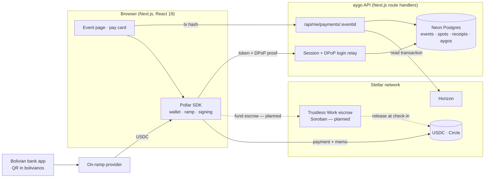

# aygo

**Events in Bolivia, paid and settled on Stellar.** Discover → reserve in one
tap → pay the ticket by scanning a Bolivian bank QR → show up → scan the QR at
the door → collect the event's **aygo** in your passport → share.

Guests pay in bolivianos from the banking app they already use. Hosts receive
USDC in a wallet they own. Nobody types a seed phrase, installs a wallet or
hears the word "blockchain": the wallet is created at sign-in with Google or
email, and the chain is the settlement layer underneath.

Live at [aygo.app](https://aygo.app) · Next.js 16 (App Router) · React 19 ·
Tailwind v4 · Neon Postgres · Pollar · Stellar.

## Contents

- [Why Stellar](#why-stellar)
- [What runs today](#what-runs-today)
- [Architecture](#architecture)
- [Stellar building blocks](#stellar-building-blocks)
- [Roadmap](#roadmap)
- [Escrowed tickets with Trustless Work](#escrowed-tickets-with-trustless-work)
- [Security model](#security-model)
- [Run it](#run-it)
- [Where things live](#where-things-live)
- [What is not built](#what-is-not-built)

## Why Stellar

Paid events in Bolivia run on trust and screenshots. The guest sends a bank
transfer, forwards a screenshot over WhatsApp, and the host ticks a name off a
list by hand. Three things break:

1. **The host cannot prove who paid.** Screenshots are edited, transfers arrive
   under another name, and reconciliation is manual.
2. **The guest has no protection.** If the event is cancelled or never happens,
   getting the money back depends on the host's goodwill.
3. **Hosts are stuck in one currency and one bank.** There is no neutral,
   dollar-denominated balance a small organizer can hold and move.

aygo uses Stellar for exactly those three things, not for storage or branding:

| Problem | What Stellar does in aygo |
| --- | --- |
| Proof of payment | Every ticket is one USDC payment to the host's own account, tagged with a memo only that guest's session can produce. The server reads it from Horizon — it never trusts the browser. |
| Guest protection | Ticket money sits in a non-custodial escrow (Trustless Work on Soroban) and is released by the door scan — see the [roadmap](#roadmap). |
| Dollar balance for hosts | Hosts are paid in USDC, in an account they control, with fees low enough for a Bs 35 ticket. |

Cheap payments, native USDC, memos, fast finality and local on/off-ramps are
why this is built on Stellar and not on a card processor: card acceptance is out
of reach for the informal organizers who run most events here, while every one
of their guests already has a banking app that scans QR codes.

## What runs today

Everything below is in production on `main` and enforced on the server.

**Product**

- Catalog by city, interest and calendar; map view; shareable event pages.
- Event creation, approvals, capacity, guest lists and host tools.
- QR check-in at the door; each check-in mints the event's **aygo** into the
  guest's passport (collection at `/u/<username>/collection`).
- Questions, reports and their threads; in-app notifications.
- Accounts that follow you across devices; mandatory unique usernames with
  public profiles at `/u/<username>`.
- Admin dashboard with weekly traction counted from the app's own data, and
  revocable public report links (`/m/<id>`).

**On Stellar**

- **A Stellar wallet for every account.** Sign-in is Pollar (`@pollar/react`
  0.12): Google or email creates a Stellar account for the user. Production
  runs on mainnet, `dev` on testnet.
- **USDC ticket payments, guest → host, non-custodial.** aygo never holds the
  money. The guest's wallet pays Circle's USDC to the host's wallet with the
  memo `aygo-<hash(session, event)>` ([`lib/server/stellar.ts`](lib/server/stellar.ts)).
- **Ledger-verified receipts.** `POST /api/me/payments/:eventId` takes a
  transaction hash, loads it from Horizon, and accepts it only if it succeeded,
  carries that guest's memo, and paid USDC from the right issuer to the host.
  Amounts are summed in stroops. A hash can be used once.
- **Pay-first spots.** A paid event's spot is "reserved" until the payment is
  verified; only then is the guest "going".
- **Bolivian bank QR in the event page.** Pollar's ramp (Stereum is the local
  provider) turns bolivianos into USDC: the guest scans one QR with their
  bank's app and the USDC is forwarded to the host.

**The one part that is not on Stellar yet.** Bolivia's bank-QR corridor
currently delivers USDC on Polygon; the BOB → USDC-on-Stellar route is not open
for this app yet. So that the product could launch, QR-funded tickets settle on
Polygon today, with the same server-side verification
([`lib/server/polygon.ts`](lib/server/polygon.ts)). The Stellar payment path
above is built and is what a `G…` host wallet uses. Moving the QR flow to
Stellar settlement is milestone 1 of the roadmap, and Polygon is removed once
it lands.

## Architecture



- **Identity.** Pollar access tokens are DPoP-bound. The browser signs a proof
  for one Pollar request; the server relays exactly that request and keys the
  account by the verified profile ([`lib/server/pollar.ts`](lib/server/pollar.ts)).
- **Money.** Keys and signing stay in the user's Pollar wallet. The server's
  only role is to read the ledger and record a receipt.
- **Data.** Postgres holds the product (events, spots, check-ins, receipts).
  The chain holds the money and, later, the escrow state.

## Stellar building blocks

| Block | Role in aygo | Status |
| --- | --- | --- |
| [Pollar](https://pollar.xyz) | Social login, embedded Stellar wallets, transaction signing, fiat ramp | Live (mainnet) |
| Stellar network + Horizon | Settlement and the source of truth for receipts | Live |
| USDC on Stellar (Circle) | The only asset a Stellar ticket is paid in | Live |
| [Trustless Work](https://www.trustlesswork.com) | Non-custodial ticket escrow on Soroban, released at check-in, refundable on cancellation | Planned — milestones 2–4 |
| Stellar-native BOB on/off-ramp | Bank QR in, bank account out, settling on Stellar | Planned — milestones 1 and 4 |
| Soroban | Attendance records (aygos) anchored on-chain | Planned — milestone 5 |

Trustless Work is on the Stellar Community Fund's Integration List.

## Roadmap

Each milestone ends in something a reviewer can open and check. Milestones 2–4
follow the testnet MVP → testnet expansion → mainnet shape.

### Done

- [x] Pollar login with a Stellar wallet per account, on mainnet
- [x] Server-verified accounts (DPoP relay)
- [x] USDC ticket payments with per-guest memos, verified on Horizon
- [x] Pay-first spots, receipts on the guest row, host-side "mark paid"
- [x] Bolivian bank QR inside the event page (Pollar ramp)
- [x] Live traction reports from app data

### 1 · Stellar-only settlement

Close the gap described above.

- BOB → USDC-on-Stellar route for the bank QR, through Pollar or a
  Stellar-native ramp that serves Bolivia
- Sponsored USDC trustlines so a new host can be paid with zero setup
- Host payout wallets are Stellar accounts only; Polygon code removed

*Verifiable:* a mainnet ticket paid by bank QR whose receipt links to
stellar.expert.

### 2 · Escrowed tickets — MVP on testnet

- One Trustless Work escrow per paid spot, funded in USDC from the guest's
  Pollar wallet
- The door scan releases the escrow to the host
- Escrow state shown on the ticket (guest) and the guest row (host)

*Verifiable:* recorded end-to-end flow on testnet — reserve, fund, check in,
release — with the escrow contract ID and transactions.

### 3 · Refunds and disputes — testnet

- Host cancels or deletes an event → every funded escrow is refunded
- Guest cancels inside the host's refund window → refund
- No-show and "event didn't happen" disputes, resolved from check-in data
- Threat model and monitoring plan published in this repo
- Unit and integration tests for the payment and escrow paths

*Verifiable:* testnet runs of each path, the test suite, and the two documents.

### 4 · Mainnet launch

- Escrow is the default for paid events on aygo.app
- Host cash-out from USDC to a Bolivian bank account
- Public on-chain footprint: escrow contract IDs and app-operated accounts
  listed here
- Success metric measured on-chain: cumulative USDC released through aygo
  escrows, and the number of escrows funded by distinct guests

*Verifiable:* mainnet escrows for real events, and the metric read from the
ledger by anyone.

### 5 · After launch

- Aygos anchored on Soroban: a check-in becomes a portable attendance record
- Multi-release escrows for multi-day events and deposits
- More cities, then neighbouring countries with their own local rails

## Escrowed tickets with Trustless Work

Trustless Work provides non-custodial escrow contracts on Soroban through an
API and SDK, so aygo integrates escrow without writing or maintaining its own
contract. A ticket maps onto its role model like this:

| Escrow role | Who | Why |
| --- | --- | --- |
| Funder | Guest | Pays the ticket in USDC into the escrow |
| Service provider / receiver | Host | Runs the event, receives the release |
| Approver | The check-in | A valid door scan is the proof the service was delivered |
| Release signer | aygo | Signs the release when the check-in is recorded |
| Dispute resolver | aygo | Splits or refunds when an event is cancelled or contested |
| Platform address | aygo | Receives the platform fee, if one is charged |

The money moves three ways:

1. **Attended.** Guest scans the door QR → release to the host.
2. **Cancelled by the host.** The app already notifies every guest when an
   event is deleted; the same action refunds every funded escrow.
3. **Contested.** No scan and a complaint → resolved from check-in records.

The check-in that already mints an aygo is the same event that releases the
money, so the escrow adds no step for guest or host.

## Security model

- **No custody.** aygo holds no user keys and no user funds — today payments go
  wallet to wallet; with escrow they sit in a contract, not with aygo.
- **The server never trusts the client.** Logins are verified with Pollar,
  payments are read from the ledger, and writes pass validation, moderation and
  rate limits (`lib/server/validate.ts`, `moderation.ts`, `rate-limit.ts`).
- **Payments cannot be replayed or borrowed.** The memo is derived from the
  session and the event, and a transaction hash is accepted once.
- **Environments are separated.** Production (mainnet, `production` database)
  and dev (testnet, `dev` database) cannot be crossed: the server refuses to
  boot on a mismatch ([`lib/server/env.ts`](lib/server/env.ts)).

## Run it

```bash
pnpm install
cp .env.example .env.local   # fill in the values (see the comments in the file)
pnpm dev
```

- `AYGO_DATA_SOURCE=memory` runs with an in-process store (resets on restart) —
  zero setup for local UI work.
- `AYGO_DATA_SOURCE=postgres` + `DATABASE_URL` uses Neon; the schema is created
  lazily on first use. `POST /api/admin/seed` (with `x-admin-token`) seeds the
  discover content. **No demo events or people are ever seeded.**
- Login and wallets need `NEXT_PUBLIC_POLLAR_PUBLISHABLE_KEY`; without it the
  app browses but can't sign in or pay.
- `NEXT_PUBLIC_POLLAR_NETWORK` is `testnet` (default) or `mainnet`. It selects
  the Stellar network, the Horizon host and the USDC issuer together.

## Where things live

| | |
| --- | --- |
| `app/` | routes — `(app)/*` app chrome, `[slug]` the flat namespace (city / interest / calendar / event by share code), `api/*` the backend |
| `components/` | UI, by domain (`event`, `payment`, `create`, `manage`, `passport`, `discover`, …) |
| `hooks/` | client data hooks (`use-qr-pay`, `use-bank-qr`, `use-registrations`, `use-account-session`, …) |
| `lib/stellar.ts` | network, Horizon host, USDC issuer, account and trustline checks |
| `lib/server/stellar.ts` | payment memo and Horizon verification |
| `lib/api/` | the only client → backend seam; contract in [`lib/api/README.md`](lib/api/README.md) |
| `lib/server/` | route helpers, validation, moderation, sessions, Pollar verification, the store (`memory` / `postgres`) |

## What is not built

Stated plainly, so nothing here reads as more than it is:

- Escrow, refunds and disputes — roadmap milestones 2–4. Today a paid ticket is
  a direct payment and a refund is between guest and host.
- Bank-QR tickets settling on Stellar — milestone 1 (they settle on Polygon
  today).
- Host cash-out to a bank account inside the app — milestone 4.
- On-chain aygos — milestone 5. Today an aygo is a server-side record.
- Email, SMS and push notifications — in-app only.
